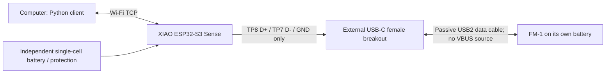

# FM-1 recovery over Wi-Fi with the XIAO ESP32-S3 Sense

Recover an M-VAVE FM-1 that no longer enumerates over USB using its JieLi ROM,
a battery-powered Seeed XIAO ESP32-S3 Sense, and a Python TCP client.

**A real FM-1 was restored to stock V15 on 2026-11-21.** Its application was
written and read back successfully, the complete final 1 MiB image matched
the planned SHA-256, the boot head and all data above the application were
unchanged, and the owner reported that it booted normally. This is one hardware
case, not a guarantee for every FM-1, cable, battery or breakout.

This adaptation builds on [dag's ESP32-S3 port](https://github.com/dagnazty/fm1-esp32-unbrick),
[FM-1 Transporter](https://github.com/kurogedelic/FM-1-transporter),
[MvaveFM1Unbricker](https://github.com/Quixotic7/MvaveFM1Unbricker), and
[jl-uboot-tool](https://github.com/kagaimiq/jl-uboot-tool). It replaces the
computer-facing UART with Wi-Fi; USB entry/timing and flash algorithms remain
upstream-derived. The [original README](README.upstream.md) is
preserved for attribution and history; its dual-port/UART wiring is NOT the
XIAO wiring below.

## Read before connecting anything

- This is a **nonstandard, VBUS-free ROM recovery link**, not a normal USB-C host.
- The XIAO's **built-in USB-C port is programming-only** and must be EMPTY
  during target recovery. Do not leave Mac USB data connected.
- **Do not supply breakout VBUS.** Connect only native D+, D− and common ground.
- Confirm your board revision, pad identity, actual breakout CC circuitry,
  power polarity/isolation, continuity and absence of shorts with suitable
  instruments. A lit LED, a photo, labels or one successful boot are not measurements.
- Never alter wiring live or apply 5 V to GPIO/battery contacts.
- Begin with read-only firmware. Take two matching original full reads and an
  independent protected copy. Review the exact offline plan before permitting writes.
- No head/full-image restoration, OTA cleanup, factory-settings reset or device-data
  writes are offered through this path. Do not bypass a rejected identity.

The successful case's generic red breakout had unknown CC components and no
recorded multimeter verification. **That is an unresolved limitation of the
case, not a recommendation to skip verification in a reproduction.** See
[WIRING.md](docs/WIRING.md) before proceeding.

## Hardware architecture



| XIAO underside connection | External breakout | Meaning |
|---|---|---|
| **TP8** | **D+** | GPIO20 / native USB D+ |
| **TP7** | **D−** | GPIO19 / native USB D− |
| **GND** | **GND** | Common reference |
| No supply connection | **VBUS** | Leave unwired to all XIAO/battery/charger supplies; insulate |
| No external XIAO connection | **CC1, CC2** | Assess existing breakout components; do not add guessed resistors |

TP7/TP8 are on the chip side of the receptacle's 22 Ω series resistors.
The test-pad route bypasses them and leaves the unused receptacle branch as
a stub. Do not confuse XIAO ESP32-S3 pins with RP2040 D6/D7 instructions.
The external breakout shares the native controller; it is not a second USB port.

The computer reaches the XIAO AP directly. It has no Internet uplink. If this
is your only network interface, manually joining the AP interrupts Internet
and an online assistant session. Prepare an offline guide first; this project
never switches your network automatically.

## What is supported

| Item | Status |
|---|---|
| XIAO ESP32-S3 Sense, 8 MiB flash / 8 MiB octal PSRAM | Hardware case completed |
| macOS, Python 3.12, ESP-IDF 5.4.1 | Case environment |
| Native USB_KEY, oscillator calibration, host handoff | Observed on actual target |
| JieLi ROM 4C4A:8057, WL82 UBOOT1.00 | Observed |
| Key 980F, type 3, flash 856014 | Observed and restored |
| Flash B36014 | Accepted by pinned upstream checks; not hardware-tested in this case |
| Authenticated TCP, CRC/sequence checks, partial reads | Software tests and actual operation |
| Public V15 application 0x04000..0x92FFF | Restored with full verification |
| V16 / SLOOP restoration, head writes, OTA cleanup | Not offered by this guarded workflow |
| Other boards/OS/cables/CC circuits | No hardware validation claimed |

## Start here

Clone a published fork/release **containing this adaptation**. The original
upstream repository alone does not contain these Wi-Fi files. Do not use a
path with spaces. Keep your work private until you separate device evidence
and credentials from publishable source.

```bash
cd /path/without/spaces/fm1-esp32-unbrick
python3.12 -m venv .venv
.venv/bin/python -m pip install -r requirements-dev.txt
sh tools/fetch_deps.sh
# New setup only: refuses to replace existing credentials without --rotate.
.venv/bin/python tools/configure_wifi.py
```

Install ESP-IDF **v5.4.1** and its ESP32-S3 tools as described in
[BUILD_AND_FLASH.md](docs/BUILD_AND_FLASH.md). Preserve the XIAO's original
flash before replacement. Then:

```bash
bash tools/build_firmware.sh diagnostic
bash tools/build_firmware.sh recovery
```

| Mode | Output | Native USB / writes |
|---|---|---|
| `diagnostic` | `build/` | USB setup console; USB recovery disabled; TCP loopback selftests |
| `recovery` | `build-recovery/` | Native recovery enabled; flash writes disabled |
| `approved-v15 --enable-app-writes` | `build-approved-v15/` | Explicitly write-capable, existing application-only range unchanged |

Each image embeds **your** Wi-Fi password and TCP secret. Do not publish build
binaries, ELF files, generated configs, boot logs or private controller bundles.
Generated credentials have no default public secret. Read the password from
your own `wifi_credentials.json`.

### Program, then hand off to battery and Wi-Fi

With the target detached, enter XIAO download mode and find the actual serial
port. On the case Mac, cold removal of **both battery and USB power**, then
holding BOOT while reconnecting USB, restored a missing port when RESET did not.

```bash
ls /dev/cu.usbmodem*
# Set the actual XIAO path from the listing; do not guess with multiple boards.
FM1_XIAO_PORT=/dev/cu.usbmodem_REPLACE_ME
.venv/bin/python -m esptool --chip esp32s3 --port "$FM1_XIAO_PORT" \
  --after no-reset write-flash --flash-mode dio --flash-size 8MB --flash-freq 80m \
  0x0 build-recovery/bootloader/bootloader.bin \
  0x8000 build-recovery/partition_table/partition-table.bin \
  0x10000 build-recovery/fm1_esp32_unbrick.bin
```

Require all esptool hash checks to pass and `Staying in bootloader.`
**Unplug computer USB before starting recovery firmware.** Power the XIAO
from its checked battery supply, leave built-in USB-C empty, and manually join
its AP. With the FM-1 still detached:

```bash
.venv/bin/python tools/wifi_recover.py ping
.venv/bin/python tools/wifi_recover.py log
```

Require PONG and actual USB_KEY recovery-stage logs.
`USB_RECOVERY_DISABLED` means diagnostic firmware, not a target failure.
The log command drains a rolling buffer: save each capture under a new filename.

### Detect and obtain two original backups in one session

Once electrical checks pass, use an already prepared USB_KEY-waiting session,
FM-1 initially OFF, batteries independent, and the external breakout connection.
Start the command, then promptly switch the FM-1 ON when it waits:

```bash
mkdir -p backups
FM1_DUMP=$(mktemp -d "$PWD/backups/original-XXXXXXXX")
set -o pipefail
.venv/bin/python tools/wifi_recover.py dump "$FM1_DUMP" --wait 180 \
  2>&1 | tee "$FM1_DUMP/session.log"
.venv/bin/python tools/wifi_recover.py log 2>&1 | tee "$FM1_DUMP/board-after.log"
```

Never add `--dry-run`/`--mock-flash` to a real backup: those can select simulated
data. Dump checks actual identity first, reads the full flash twice, requires
byte equality, preserves both files and an analysis manifest, and performs no
flash writes. On failure, stop and retain evidence; do not automatically reset.
After a detach, the current firmware does not restart USB_KEY by itself.

### Offline plan and separately approved restoration

Obtain the public V15 package from the source in [UPSTREAM.md](docs/UPSTREAM.md),
verify its pinned hash, then create a plan from **your own** matching reads:

```bash
.venv/bin/python tools/prepare_v15_plan.py \
  --backup-dir "$FM1_DUMP" \
  --package /path/to/V15-FM-1.fwsc \
  --immutable-backup "$PWD/backups/independent-original.bin" \
  --out "$FM1_DUMP/v15-approval.json"
```

This is offline only; **creating a plan is not write approval**. Review every
sector, preserve all outside data, and explicitly approve the exact plan.
Different units have different original/final hashes and may have a different
sector count. Do not copy the case study's 143-sector approval onto another unit.

The public per-unit manifest path is a software-tested generalization added
after the successful recovery. The case used the historical fixed-hash guard.
It has not been hardware-retested on a second unit. The legacy no-manifest
option remains locked to that original case, not a universal write switch.

After approval, build/deploy the write-capable image using the same target-
detached/no-reset procedure. This necessarily ends an old live USB session;
prepare a new physical attempt afterward. Do not flash the XIAO with the FM-1
attached. Then follow the full [reproduction runbook](docs/REPRODUCING.md):

```bash
bash tools/build_firmware.sh approved-v15 --enable-app-writes
# After separate safe deployment, battery handoff and manual Wi-Fi join:
.venv/bin/python tools/wifi_recover.py --approved-v15 \
  --approval-plan "$FM1_DUMP/v15-approval.json" --evidence-dir "$FM1_DUMP/live-restore" \
  restore /path/to/V15-FM-1.fwsc --ref "$FM1_DUMP/full-flash-before-1.bin" \
  --verify-v15 --write --wait 180
```

The default upstream typed WRITE confirmation is retained (omit `--yes` unless
you have deliberately approved noninteractive execution). This command checks
fresh live identity and a fresh **entire flash** against the original, permits
only the exact approved sector sequence/payloads, journals each acknowledgment,
and requires final full-image equality. No protected-data change is tolerated.

## Successful shutdown

Only after exit status zero, `Final full read EQUALS...` and
`RESTORE_VERIFIED.json` all agree:

1. Switch FM-1 OFF first while its cable remains attached.
2. Once off, disconnect its USB cable from the external breakout.
3. Power down the XIAO using its battery connector/switch.
4. Boot FM-1 normally with USB disconnected and observe the screen.

If a write/verification fails, keep both devices powered and recovery wiring
connected. Save the evidence directory; do not reset, blindly retry, widen the
write range or run settings/full-image repair. Generic upstream retry advice
is not permission to replay an operation whose result is uncertain.

## Documentation

- [Full reproducible action](docs/REPRODUCING.md)
- [Hardware, CC/VBUS and electrical checks](docs/WIRING.md)
- [ESP-IDF, build modes, original-board backup, flashing](docs/BUILD_AND_FLASH.md)
- [Architecture and TCP protocol](docs/ARCHITECTURE.md)
- [Errors, root causes, workarounds](docs/TROUBLESHOOTING.md)
- [Completed case, evidence and known limitations](docs/CASE_STUDY_2026-11-21.md)
- [Real ROM status/detach investigation](docs/ROM_STATUS_FIX.md)
- [Restoration invariants and failure policy](docs/RECOVERY_SAFETY.md)
- [Source revisions, firmware hashes and licensing](docs/UPSTREAM.md)
- [Preserving private evidence / publishing safely](docs/PRESERVATION_AND_PUBLICATION.md)
- [Tests and validation coverage](docs/VALIDATION.md)

## Tests

```bash
sh tools/fetch_deps.sh
.venv/bin/python -m pytest tests -q
```

Ordinary tests do not touch hardware. Optional case-fixture tests skip when
private dumps/firmware are absent. CI fetches pinned dependencies, verifies the
loader hash and runs software tests; it does not validate USB timing, electrical
wiring or another FM-1. See VALIDATION.md for the separate pinned-upstream tests.

## License and redistribution

MIT; preserve [LICENSE](LICENSE) and upstream notices. Schematics are linked to
Seeed rather than relicensed here. The proprietary JieLi loader and M-VAVE
firmware are fetched/obtained separately; **neither is committed**. A loader
hash check proves file identity, not a redistribution license. Device dumps,
credentials, generated binaries and private evidence must not be published.

M-VAVE/FM-1 and Seeed names identify compatible hardware; this is an unofficial
community project with no manufacturer affiliation or warranty.
